# GittyGotchi

A tiny creature that lives on your GitHub profile.

No login. No token. Just add your Gitty.

[](https://gittygotchi.alpdogan.co/alpdogan)

## Get yours

Replace `YOUR_USERNAME`:

[](https://gittygotchi.alpdogan.co/YOUR_USERNAME)

Or generate the snippet at [https://gittygotchi.alpdogan.co](https://gittygotchi.alpdogan.co).

The whole image is clickable because the README wraps the SVG in a Markdown link. Do not rely on links inside the SVG.

## How it works

Everyone starts with an egg.

GitHub account history influences which class hatches.

Activity after adoption determines growth.

## Classes

- Earth
- Water
- Air
- Fire
- Psy

Earth, Water, Air, and Fire are equal normal classes. None of them is stronger than the others.

Class is assigned at adoption and does not change afterward.

## States

Gitty can look hungry, happy, excited, sleeping, resting, or hibernating. It never dies. Weekends are not punished. Long inactivity becomes hibernation, then Gitty wakes when activity returns.

## Privacy

No OAuth.

No PAT.

No GitHub login.

No access to private repository contents.

Only publicly exposed GitHub data is consumed.

GitHub contribution graphs may include anonymized private activity depending on the GitHub user's privacy settings.

## Architecture

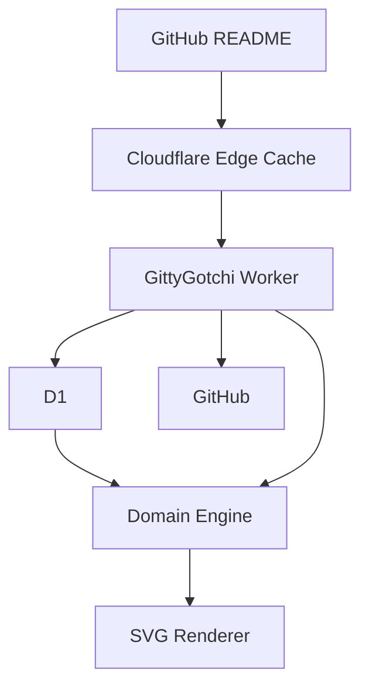

The Worker serves a polished landing page and share pages plus a cached preview Gitty SVG. The renderer can draw every growth stage and class; live pet state is not wired to HTTP yet.

## Looks

Everyone starts as an egg. Growth and class art is ready in the renderer.

<p align="center">
	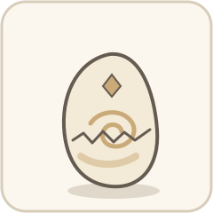
	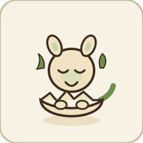
	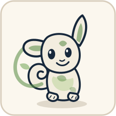
	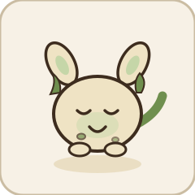
	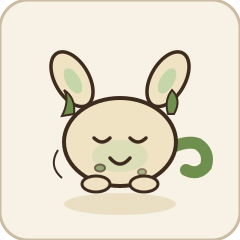
	
</p>

<p align="center">
	
	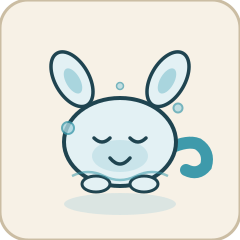
	
	
	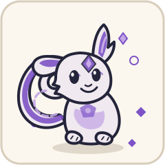
</p>

<p align="center">
	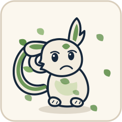
	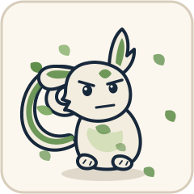
	
	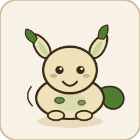
	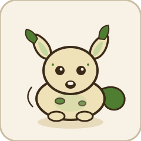
</p>

<p align="center">
	
	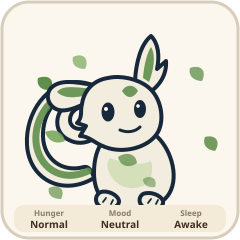
	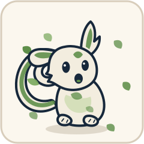
	
</p>

<p align="center">
	
	
	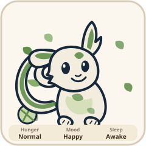
	
	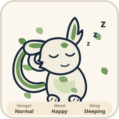
	
	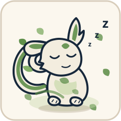
</p>

GitHub fetching, the domain engine, and the D1 repository exist in the repo but are not wired to HTTP yet.

## Development

Prerequisites: Node 24 and pnpm 12.

```bash
corepack enable
corepack prepare pnpm@12.3.4 --activate
pnpm install
lefthook install
pnpm dev
```

`pnpm dev` starts Wrangler locally at `http://localhost:8787`.

## Testing

```bash
pnpm check
```

That runs format check, lint, typecheck, and tests. CI does not call live GitHub.

## Deployment

See [CONTRIBUTING.md](CONTRIBUTING.md) for D1, Wrangler, and production notes. CI never deploys. Production deploys only from protected `main` or a tagged release.

## Contributing

See [CONTRIBUTING.md](CONTRIBUTING.md) and [docs/GITHUB_RULESET.md](docs/GITHUB_RULESET.md).

## Security

See [SECURITY.md](SECURITY.md).

## License

[MIT](LICENSE)
